# RenAIssance

RenAIssance turns scans of 16th–17th century Spanish printed books into clean, editable text. It is a full-stack app (React + FastAPI) built around a four-stage OCR pipeline: **image preprocessing → text detection → text recognition → LLM post-processing**.

This README walks through the problem and then builds the solution one stage at a time. The page figures all use the **same page** (*PORCONES.23.5, 1628*), so you can follow it through the whole pipeline; the result charts cover the full held-out test set.

- [1. The problem: modern OCR fails on old books](#1-the-problem-modern-ocr-fails-on-old-books)
- [2. The solution: a four-stage pipeline](#2-the-solution-a-four-stage-pipeline)
- [3. Image preprocessing](#3-image-preprocessing)
- [4. Text detection](#4-text-detection)
- [5. Text recognition](#5-text-recognition)
- [6. LLM post-processing](#6-llm-post-processing)
- [Project structure](#project-structure)
- [Running the app](#running-the-app)

---

## 1. The problem: modern OCR fails on old books

Here is Tesseract 5 with its Spanish model on our sample page:

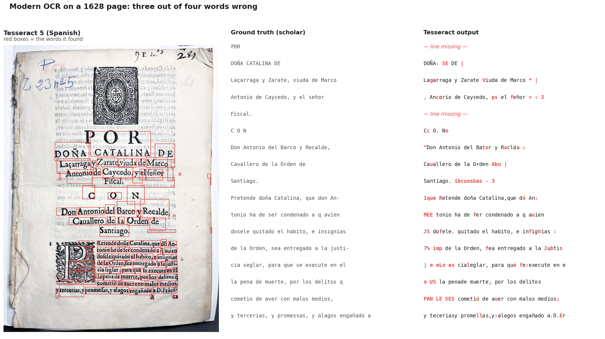

| Engine | Sample page: CER / WER | All 28 test pages: CER / WER |
|---|---|---|
| Tesseract 5, Spanish (`spa`) | **33% / 79%** | **18.6% / 59.5%** |
| Tesseract 5, old Spanish (`spa_old`) | 37% / 89% | 19.5% / 61.3% |

On this page about four words in five are wrong; across all 28 test pages ([section 5](#training-data)), three in five. The old-Spanish model is worse, not better. The failures have clear causes:

| What is on the page | What modern OCR does |
|---|---|
| **Old letter forms**: the long-s `ſ` looks like `f` | `señor` → `feñor`, `ser` → `fer`, `insignias` → `infignias` |
| **Decorations**: a woodcut and a decorated drop cap | Read as text: `Ny`, `Nue`, `Th fuma` |
| **Spaced or large type**: `P O R`, `C O N` | The title `POR` is lost, `CATALINA` disappears |
| **Bleed-through** from the reverse side, paper texture | Junk words such as `Aibcu bos` |
| **Old spelling** (`cometio`, `Orden` without accents) | Modern accents are added: `cometió`, `Ordén` |

Modern engines are trained on modern fonts, clean scans and modern spelling. Old books break all three assumptions, so a single off-the-shelf model is not enough.

---

## 2. The solution: a four-stage pipeline

Each stage removes one class of error before the next stage sees the page.

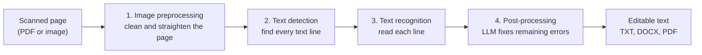

| Stage | Input → output | Fixes | Tools |
|---|---|---|---|
| 1. Image preprocessing | page → clean page | bleed-through, noise, skew, faint ink | OpenCV |
| 2. Text detection | clean page → one box per line, in reading order | decorations, margins, broken lines | PaddleOCR layout + text detection |
| 3. Text recognition | line image → text | old letter forms and fonts | CRNN (trained from scratch), fine-tuned TrOCR, or Gemini / GPT |
| 4. Post-processing | raw text → corrected text | leftover character and word errors (worth it on weak OCR) | Fine-tuned Gemma-3-4B, or a cloud LLM |

---

## 3. Image preprocessing

**Goal:** give the models a page that looks as close as possible to clean black text on white paper.

Preprocessing is a pipeline of OpenCV operations. The user picks the operations, tunes them, and sees a live before/after preview. Here is what each one does to a crop of our page:

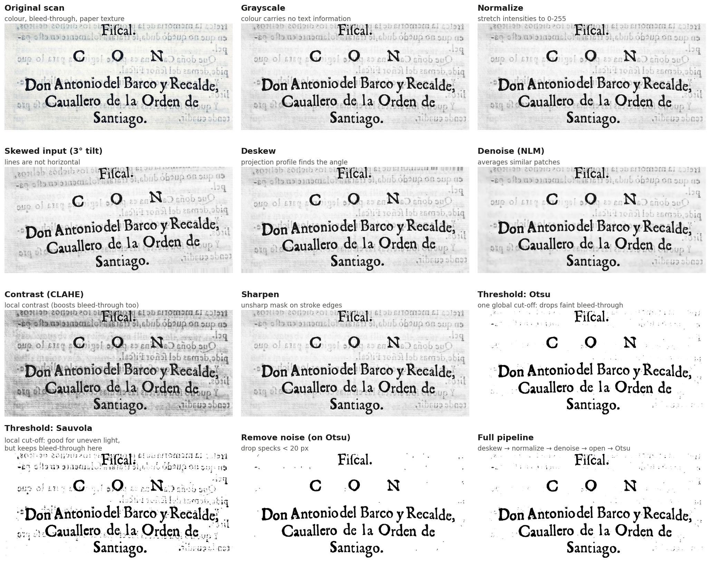

| Operation | What it does | Use it for |
|---|---|---|
| Grayscale | Drops colour | Always first; colour carries no text |
| Normalize | Stretches brightness to the full 0–255 range | Faded, low-contrast scans |
| Deskew | Rotates the page so text lines are horizontal | Tilted scans (details below) |
| Denoise (NLM) | Replaces each pixel by an average of similar-looking patches | Paper grain, without blurring letters |
| Contrast (CLAHE) | Boosts contrast tile by tile | Uneven lighting |
| Sharpen | Adds back edge detail (unsharp mask) | Soft, blurry scans |
| Threshold | Turns every pixel black or white | Before detection and recognition |
| Morphology | Grows or shrinks ink shapes (open, close, dilate, erode) | Thin artifacts, broken strokes |
| Remove noise | Deletes ink specks smaller than *N* pixels | Dust and scanner speckle |
| Remove blobs | Deletes large, solid ink blots but keeps letters touching them | Ink stains |

**The key lesson: no pipeline fits every book.** The grid shows it. On this page the ghost text from the reverse side is lighter than real ink everywhere, so **Otsu** (one global cut-off) removes it cleanly. **Sauvola** (a cut-off computed per neighbourhood) is usually the better choice for uneven lighting, but here it keeps the ghost text, and CLAHE makes it even stronger. So the app lets the user experiment, and offers tested **book-type presets** as a starting point. The "Full pipeline" tile is the recipe we use for PORCONES scans:

`grayscale → deskew → normalize → denoise → morphological open → Otsu threshold`

**But measure before you clean.** On the 28 full test pages, this recipe makes the whole pipeline worse: CRNN page CER goes from **5.9% on the raw scans to 14.2%** after preprocessing, and TrOCR from 6.1% to 11.8%. Detection loses more lines, and the recognizers were trained on grayscale line crops, so binarized lines look unfamiliar to them. Preprocessing still helps individual hard pages (like the sample page) and helps people read; it should be chosen per page, not applied everywhere.

**Deskew, including warped pages.** A page is straight when its text lines are horizontal. Deskew finds the angle by rotating the page slightly and counting ink per row: at the correct angle, rows alternate sharply between full lines and empty gaps. Old books are often straight at the top but tilted near the spine, so deskew measures the angle separately in horizontal bands. If the bands agree, it rotates the page once. If not, it rotates each band by its own angle and blends neighbouring bands smoothly, so no seam is visible.

> Code: [`backend/preprocessing/operations.py`](backend/preprocessing/operations.py) · Notebook: [`experimentation/notebooks/02_preprocessing.ipynb`](experimentation/notebooks/02_preprocessing.ipynb)

---

## 4. Text detection

**Goal:** draw exactly one box around each line of text, in reading order. The recognition models in stage 3 read one line at a time, so they need clean line crops.

### Why two stages

Running a text detector straight on the whole page finds too much and too little at once. It boxes every speck, shelf mark and decoration, and it breaks real lines into pieces. So detection runs in two stages:

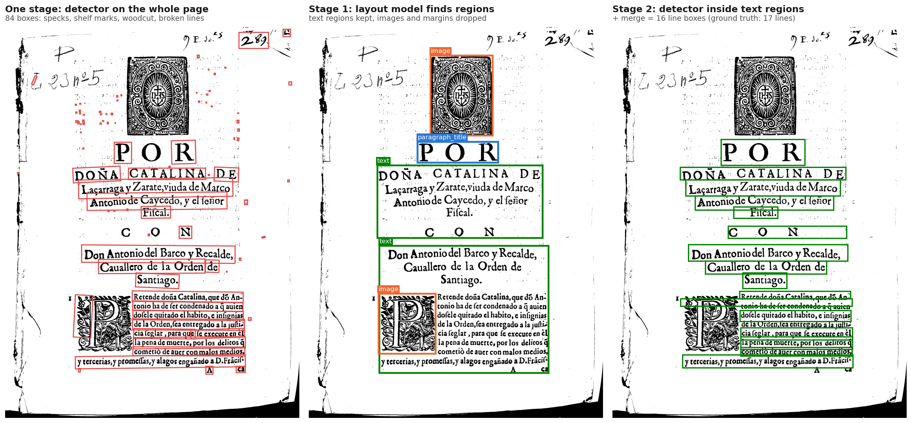

| | One stage | Two stages |
|---|---|---|
| Boxes on this page | 84 (specks, margin marks, woodcut, fragments) | **16 line boxes** (ground truth: 17 lines) |

1. **Stage 1: layout.** A layout model ([`PP-DocLayout_plus-L`](https://github.com/PaddlePaddle/PaddleOCR)) looks at the whole page and labels its regions: text, title, image, header, footnote and so on. We keep only the text and title regions. Images such as the woodcut, and anything in the outer margins, are thrown away. *This stage answers "where is the body text?"*
2. **Stage 2: lines.** The text detector ([`PP-OCRv5_server_det`](https://github.com/PaddlePaddle/PaddleOCR)) runs **inside each text region only**, at full resolution. Small regions such as a one-line title are enlarged 2×, and every region gets a white border so text at its edge is not missed. *This stage answers "where exactly is each line?"*

**How the text detector works, in one paragraph.** The model looks at the image and paints a heat map: for every pixel, how likely is it to be in the middle of a text line? It also learns its own cut-off for each pixel, which helps separate lines that sit close together. Pixels above the cut-off form "cores" of text. Each core is grown back to the full size of the line and turned into a box. (This method is called DB, *Differentiable Binarization*.)

### Merging: from pieces to lines

Even inside a region, the detector often returns a line in pieces. Spaced capitals (`C O N`) and wide gaps (`DOÑA CATALINA DE`) are the usual cause. Three simple steps fix this:

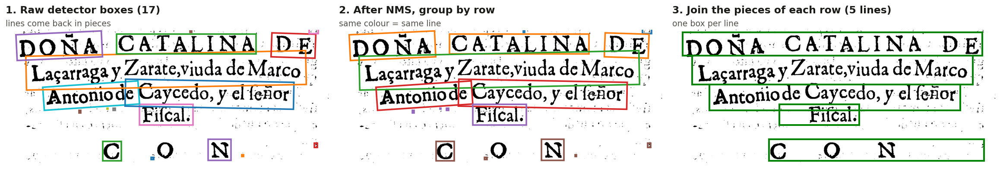

1. **Remove duplicates (NMS).** Regions can overlap, so the same text can be detected twice. When two boxes overlap a lot, keep the more confident one and drop the other. "A lot" is measured with **IoU**:

   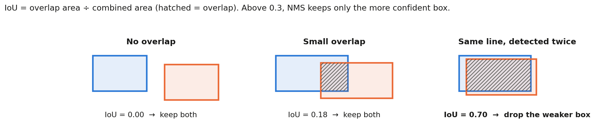

   **IoU = overlap area ÷ combined area.** If IoU is above 0.3, the boxes are treated as the same text.
2. **Group boxes into rows.** Two boxes belong to the same line if their vertical centres are closer than half a typical line height.
3. **Join each row.** Within a row, sort the pieces left to right and join neighbours whose gap is less than 2× a typical box width. A bigger gap means a separate column. Each group becomes one line box. Boxes that are tiny compared with a normal line, such as leftover specks, are dropped.

On this page: **38 raw boxes → 36 after removing duplicates → 16 line boxes**, sorted top to bottom and left to right.

**On all 28 test pages** (books no model was trained on), detection on the raw scans finds about one box per true line and loses **17 of 588 lines**. Preprocessing helps this decorated title page (raw: 14 lines, the `C O N … Santiago` block is missed), but on the whole test set it makes detection worse: **58 of 588 lines lost**, mostly on the low-resolution Padilla scans.

### Memory and hardware

Measured on an RTX 4060 laptop GPU (8 GB):

| Model | Weights | GPU memory | Time per page |
|---|---|---|---|
| Layout (`PP-DocLayout_plus-L`) | 125 MB | 0.55 GB (any page size; it resizes to 800×800) | 0.07 s |
| Text detector (`PP-OCRv5_server_det`), full 3024×4032 page | 85 MB | **6.6 GB** | 3.3 s |
| Text detector, mobile version, same page | 5 MB | 1.7 GB | 0.9 s |

The detector's weights are small. The memory goes to the image itself: the detector is a fully convolutional network, so its working memory grows with the number of pixels. This is one more reason to run it on cropped regions instead of the whole page. The app also checks free GPU memory at runtime. It uses the server models with ≥ 6 GB free, the mobile models with ≥ 2 GB, and the CPU otherwise.

> Code: [`backend/app/services/layout_detection.py`](backend/app/services/layout_detection.py) · Notebook: [`experimentation/notebooks/03_text_detection.ipynb`](experimentation/notebooks/03_text_detection.ipynb)

---

## 5. Text recognition

**Goal:** turn each detected line image into text.

The app offers two local models trained for these books, a **CNN-BiLSTM (CRNN)** and a fine-tuned **TrOCR**, plus cloud vision models (Gemini, GPT) that read the whole page. Both local models are trained and tested on exactly the same data, so their numbers can be compared directly.

### Training data

We train on [`renaissanceocr-spanish-printed`](https://huggingface.co/datasets/Human-AI-renAIssance/renaissanceocr-spanish-printed): **3,807 line images** from early modern Spanish printed books, each with a hand-checked transcription. About 60% of the lines are roman type and 38% gothic. The transcribers wrote the long-s `ſ` as `s`, so the models learn to output a normalized `s`.

> **First attempt:** we built a dataset ourselves by pairing each detected line box with the next line of a scholar's page transcript. It produced only 775 lines from 6 books, and one missed or extra box shifts every following label on the page. That idea lives on in the app's **Dataset mode**, which adds a manual review step for exactly this pairing problem.

| Preparation step | What we do | Why |
|---|---|---|
| Split **by book**, not by line | 23 books (2,956 lines) train, 3 books (851 lines) validate. Every experiment uses the same split. | The models are tested on books they have never seen. A random line split leaks each book's typeface into training and inflates the score. |
| Clean the labels | Collapse stray tabs and double spaces; drop one corrupt sample (a whole text block labelled as a single line) | Garbage labels teach garbage |
| Page-level test set | 28 transcribed pages from books no model trained on (Padilla 18, Buendía 5, PORCONES.23.5 5), rendered from the PDFs at scan resolution | Measures the whole pipeline: detection + recognition together |

### Model 1: CNN + BiLSTM + CTC (CRNN)

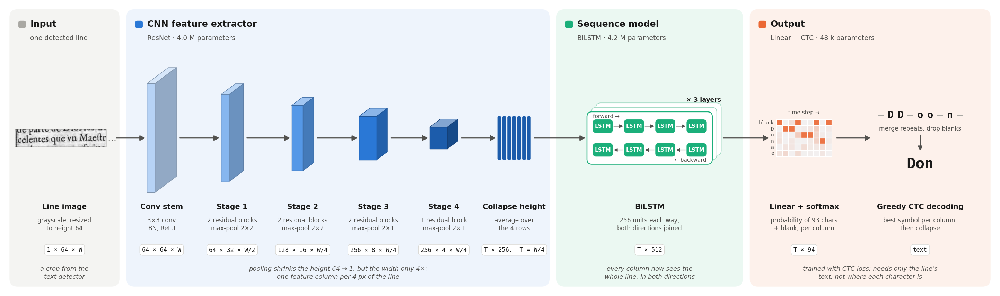

1. **CNN (a small ResNet).** The pooling shrinks the **height** from 64 to 1 but the **width** only 4×. The line becomes a left-to-right sequence of **T = W/4 columns**, each described by 256 numbers.
2. **BiLSTM (3 layers).** Reads the columns in both directions, so a glyph that is ambiguous on its own (`c`/`e`, `u`/`n`, `f`/`ſ`) is resolved by its neighbours.
3. **Linear + softmax.** For **every column at once** it gives a probability for every character plus a special **blank**.

8.2 M parameters, trained from scratch. A line can hold up to about **W/4 characters**, a limit that grows with the line: our longest line (106 characters) gets 349 columns.

**The loss: CTC.** We know each line's text but not *where* each character is, so plain cross-entropy (one target per column) is impossible. CTC lets the model output any column sequence that collapses to the right text: **merge repeats, then drop blanks**, `- D D - o o - n -` → `Don`. The loss sums the probability of every such sequence with dynamic programming, so the network **learns the alignment by itself**. A blank between two equal letters keeps `ll` in `Cauallero` as two letters.

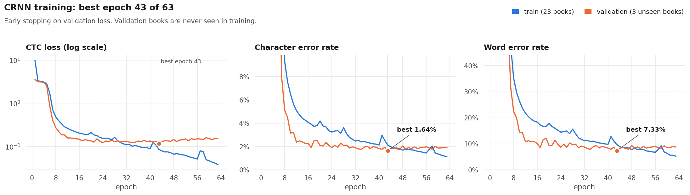

AdamW (learning rate 3e-4) with a one-cycle schedule, batch 16, mixed precision, early stopping on validation loss. Best at **epoch 43**; early stopping ended the run at epoch 63 (about 70 s per epoch on an RTX 4060). Validation error tracks training error, so the model generalizes to unseen books.

### Model 2: TrOCR (Vision Transformer + Transformer decoder)

TrOCR is fine-tuned from Microsoft's `trocr-base-printed` (334 M parameters). The **encoder** resizes the line to 384×384, cuts it into 576 patches and lets every patch attend to every other. The **decoder** writes the text one BPE token at a time (about 2.8 characters per token), and at each step **cross-attention** decides which patches to look at. Because it writes tokens in order, it trains with ordinary cross-entropy; attention does the alignment that CTC does in the CRNN.

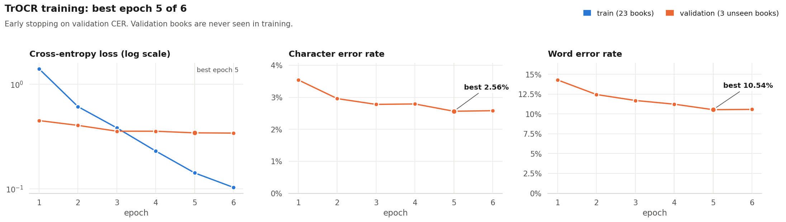

The first fine-tune was **unstable**: its training loss rose after epoch 2. Two causes, both fixed: the start token was overridden away from the one the model was pretrained with, and the learning rate (5e-5, batch 4) was too aggressive for a 334 M model. The new run keeps the pretrained start token, uses learning rate 2e-5 with warm-up and cosine decay, an effective batch of 16 and bf16. It improves every epoch: **best at epoch 5 of 6**, about 3 minutes per epoch.

### Results: same data, comparable numbers

| | Lines: CER / WER | Pages, raw scan: CER / WER | Size | Speed (GPU) |
|---|---|---|---|---|
| **CRNN** | **1.64% / 7.31%** | 5.90% / 21.67% | 8 M | 9 ms / line |
| **TrOCR** (fp16) | 2.57% / 10.54% | **6.08% / 21.34%** | 334 M | 34 ms / line |
| Tesseract 5, Spanish (off the shelf, on our line crops) | 14.27% / 57.99% | 16.85% / 59.04% | | |
| Tesseract 5, Spanish (off the shelf, finding its own lines) | same crops as above | 18.61% / 59.53% | | |

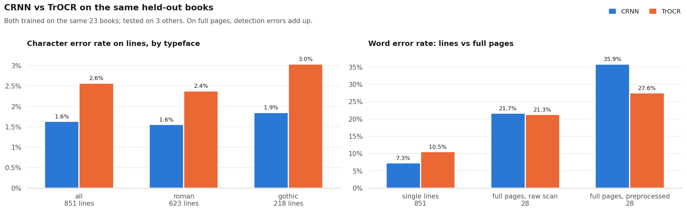

- **On clean line crops the CRNN wins** (1.6% vs 2.6% CER), on roman and gothic type alike, at 1/40 of the size and almost 4× the speed. It reads **66%** of validation lines perfectly, TrOCR 53%.
- **On full pages they are level.** TrOCR copes better with imperfect crops from the detector, and with binarized pages.
- **Against off-the-shelf OCR, the pipeline cuts page error about 3×:** 18.6% → 5.9% CER, 60% → 22% WER. Our detection helps even Tesseract: reading our line boxes instead of finding its own lines brings it from 18.6% to 16.9%.
- **Page error is about 3× line error.** On raw scans the detector loses 17 of 588 lines, and the crops it cuts are harder than the curated training crops (CER on the lines it found: 4.1% vs 1.6%). **Detection is the weakest link at page level.**
- TrOCR's decoder is a language model, which shows: on one line the CRNN reads `Iusticia` exactly as printed, while TrOCR "modernizes" it to `Justicia`.
- Some "errors" are mistakes in the ground truth: one transcript says `ante ela` where the page reads `ante la`, which is what both models output.

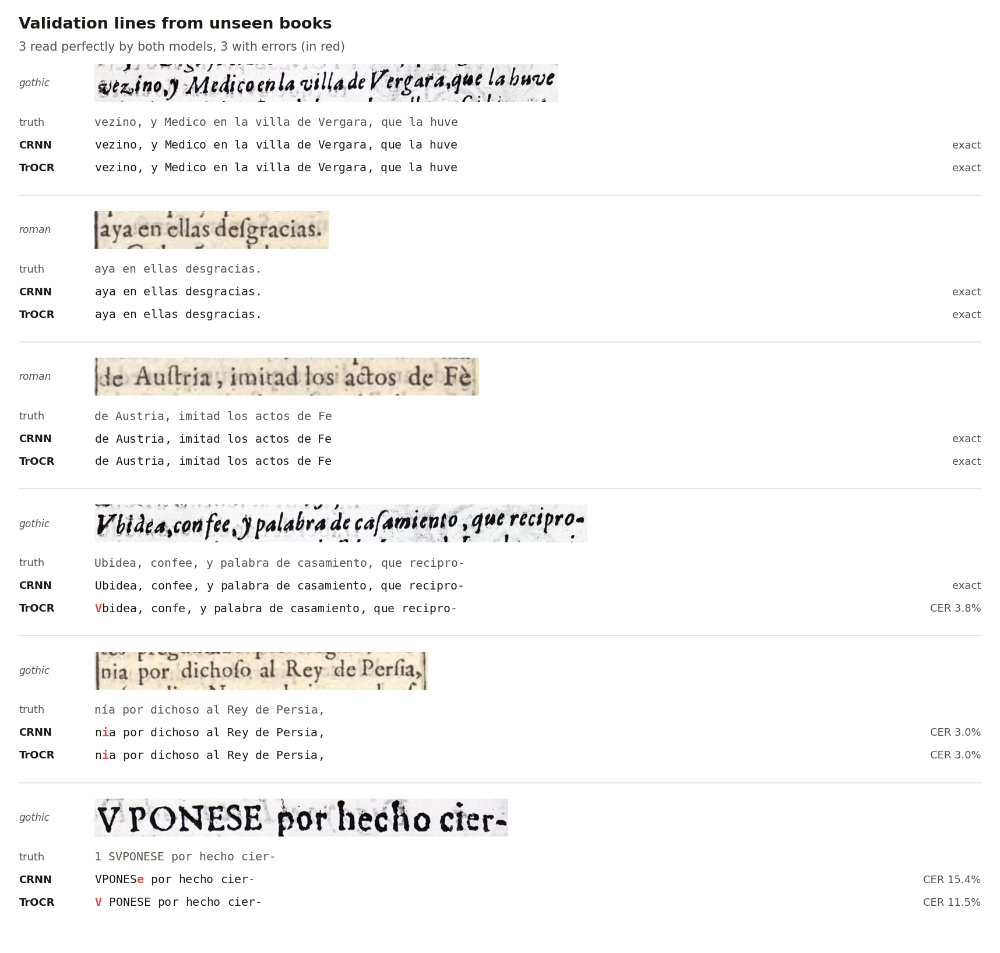

**Both models replace the previously shipped ones.** The retrained CRNN beats its predecessor on the same split (line CER 1.79% → 1.64%, WER 7.92% → 7.31%). The previous TrOCR was trained on a random line split that included 773 of these 851 validation lines, so on lines it looks better than it is; on the one book neither TrOCR had seen (PORCONES.23.5) the new model wins clearly (page CER 7.7% → 6.5%).

**The sample page, end to end.** The decorated title page is the hardest page in the test set: detection loses 2 of its 17 lines around the drop cap. Still, the pipeline cuts Tesseract's error by a third or more:

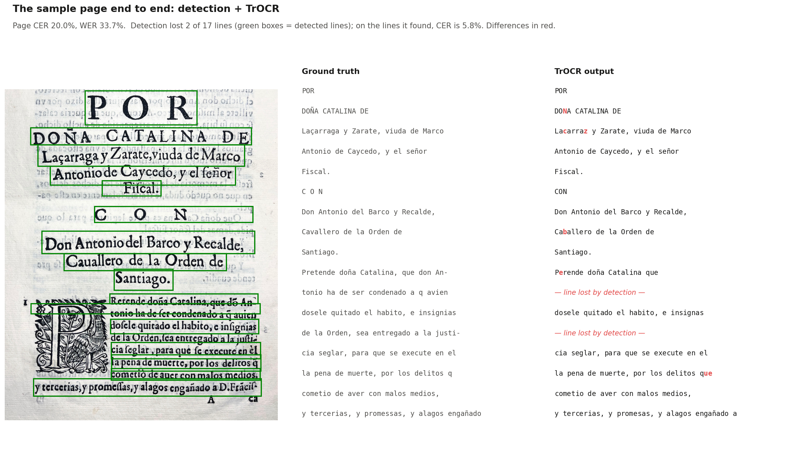

**Quantization.** The same TrOCR checkpoint loaded at lower precision (bitsandbytes):

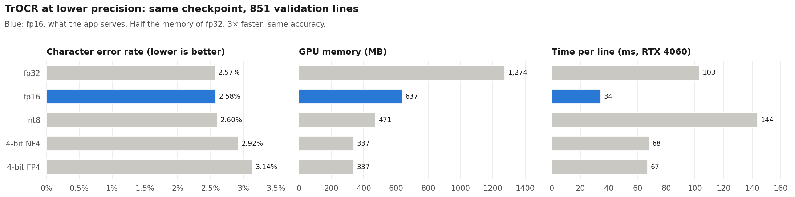

| Precision | CER | Size | ms / line |
|---|---|---|---|
| fp32 | 2.57% | 1274 MB | 103 |
| **fp16** (what the app serves) | **2.58%** | **637 MB** | **34** |
| int8 | 2.60% | 471 MB | 144 |
| 4-bit NF4 | 2.92% | 337 MB | 68 |
| 4-bit FP4 | 3.14% | 337 MB | 67 |

fp16 is free: half the memory and 3× faster at the same accuracy. int8 is smaller but *slower*, because it quantizes and dequantizes around every matrix multiply. NF4 beats FP4 because its levels follow the normal distribution of the weights.

> Code: training in [`experimentation/src/`](experimentation/src) · Notebook: [`experimentation/notebooks/04_text_recognition.ipynb`](experimentation/notebooks/04_text_recognition.ipynb) · Serving: [`backend/app/services/recognition/`](backend/app/services/recognition)

---

## 6. LLM post-processing

**Goal:** fix the character errors the recognizer leaves behind, using a language model that knows early-modern Spanish and how OCR fails.

Off-the-shelf LLMs made OCR **worse**: they modernize spelling and rewrite. So we fine-tuned two open 4 B models into line-by-line correctors with **QLoRA**: the base model is frozen in 4-bit NF4, and small rank-16 LoRA adapters (under 1% of the parameters) are trained on every attention and MLP projection.

- **Training data:** 7,614 (OCR line → true line) pairs from two engines, the stock PaddleOCR recognizer (noisy) and our first CRNN (mostly clean), so the model learns both to fix errors and to leave correct lines alone. The same book-level split holds out the same 3 books.
- **Models:** `google/gemma-3-4b-it` (shipped in the app, trained on Kaggle 2× T4) and `Qwen/Qwen3-4B-Instruct-2507` (fits an 8 GB GPU). Validation loss was lowest at step 300 (under one epoch) for both; early stopping ended training at step 600 and kept the step-300 adapters.

### Results: it depends on how good the OCR already is

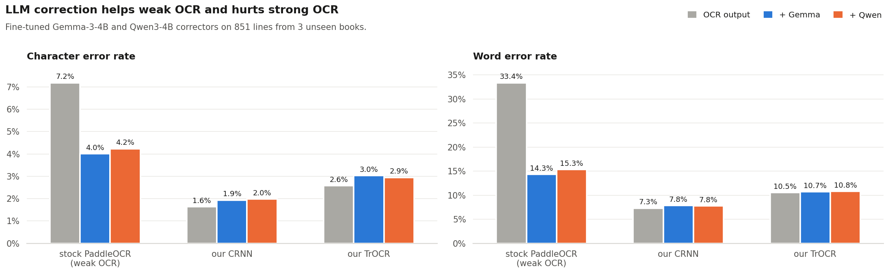

| Input (851 held-out lines) | Before: CER / WER | + Gemma | + Qwen |
|---|---|---|---|
| Tesseract 5 (weak OCR, never seen in training) | 14.27% / 57.99% | **11.46% / 34.32%** | 13.37% / 36.28% |
| Stock PaddleOCR (weak OCR) | 7.18% / 33.36% | **4.01% / 14.31%** | 4.24% / 15.34% |
| Our CRNN | 1.64% / 7.31% | 1.94% / 7.83% | 1.99% / 7.76% |
| Our TrOCR | 2.57% / 10.54% | 3.03% / 10.68% | 2.95% / 10.81% |

- **On weak OCR the corrector is a big win, on more than one engine.** Gemma cuts the word error rate of Tesseract, the engine from [section 1](#1-the-problem-modern-ocr-fails-on-old-books), from 58% to 34% (−41%), and PaddleOCR's from 33% to 14% (−57%).
- **It generalizes to an engine it never saw.** No Tesseract output was in the training data, yet of the 785 Tesseract lines Gemma changed, 594 got better and 131 worse, and perfect lines went from 17 to 101. It fixes 90% of Tesseract's long-s misreads (`fe consagra` → `se consagra`, `efta` → `esta`: 297 → 30 words).
- **On Tesseract, word error falls much more than character error** (−41% vs −20%). The corrector fixes wrong letters (2,345 → 1,482 substituted characters), and one wrong letter makes a whole word wrong. But it cannot tell junk from text, so the extra characters Tesseract invents (`Dotor de los Niños, ** 14. 2`) stay. On the 28 full test pages the word gain holds (59% → 47%) while character error rises slightly (16.9% → 17.9%).
- **On strong OCR it does more harm than good.** On the CRNN's output Gemma changed 137 of 851 lines: 35 for the better, 90 for the worse, and it broke 53 lines that were already perfect, mostly by modernizing (`Author` → `Autor`) or inventing spellings (`disseño` → `desseño`).
- **Lesson:** a corrector only pays off when the input has more errors than the corrector introduces. Our retrained recognizers are now good enough that the app should use LLM correction as an option for weak engines and hard pages, not as a default.

> Code: [`backend/app/services/llm_processing/local_client.py`](backend/app/services/llm_processing/local_client.py) · Notebook: [`experimentation/notebooks/05_llm_postprocessing.ipynb`](experimentation/notebooks/05_llm_postprocessing.ipynb)

---

## Project structure

```
backend/          FastAPI app: preprocessing, detection, recognition, LLM correction, export, auth
frontend/         React app: the upload → preprocess → detect → read wizard, and dataset mode
experimentation/  How the models were built and measured
  notebooks/      01 full pipeline · 02 preprocessing · 03 detection · 04 recognition · 05 LLM correction
  src/            corpus and split, training, page test set, evaluation, figures
  scripts/        train.py · evaluate.py · make_figures.py (long jobs, one GPU model per process)
assets/           README figures (generated by experimentation/scripts/make_figures.py)
```

The experiments import the app's own preprocessing, detection and recognizers instead of copying them, so every number above measures what the app runs. See [`experimentation/README.md`](experimentation/README.md) to reproduce them.

---

## Running the app

### What you need

- Docker version 24 or newer, with Compose v2.
- About 15 GB of free disk for the images and model weights.
- A Gemini or OpenAI API key if you want to use those engines. You enter the key in the app, not in a file.
- An NVIDIA GPU with driver 560 or newer and the NVIDIA Container Toolkit if you want GPU acceleration. This is optional. Without a GPU the app runs on the CPU image, which works everywhere and is only slower.

### Run it

Clone the repository and run the launcher for your system. It detects your GPU, checks your machine before downloading anything, and starts the correct image automatically.

#### Linux and Windows (WSL)

```bash
git clone https://github.com/<your-org>/RenAIssance.git
cd RenAIssance
./run.sh
```

Then open http://localhost:5173 in your browser. The first run downloads the images and can take several minutes. Some models download the first time you use them, and the app shows a progress bar while that happens.

Useful flags:

```bash
./run.sh --cpu     # force the CPU image
./run.sh --build   # build from source instead of pulling published images
./run.sh --down    # stop everything (your saved data is kept)
```

#### Windows (PowerShell)

```powershell
.\run.ps1          # auto-detect GPU or CPU
.\run.ps1 -Cpu     # force the CPU image
.\run.ps1 -Down    # stop
```

### Running on a Mac

Docker on macOS cannot reach the GPU, so on a Mac the app always runs on the **CPU image**. This is expected and everything works, it is just slower than on an NVIDIA machine. The local Spanish fine-tuned corrector is the only feature that requires a GPU, so on a Mac use Gemini or OpenAI for the AI cleanup step instead.

Follow these steps.

1. Install Docker Desktop for Mac from https://www.docker.com/products/docker-desktop and start it. Wait until the whale icon in the menu bar stops animating, which means Docker is ready.
2. Install Git if you do not have it. The simplest way is to run `git --version` in the Terminal, which offers to install the developer tools if Git is missing.
3. Clone the repository and enter the folder:

   ```bash
   git clone https://github.com/<your-org>/RenAIssance.git
   cd RenAIssance
   ```

4. Start the app. The launcher sees there is no NVIDIA GPU and picks the CPU image for you:

   ```bash
   ./run.sh
   ```

   If you prefer to be explicit, run `./run.sh --cpu`.

5. Wait for the download to finish. The first run pulls a few gigabytes, so give it a few minutes on a normal connection.
6. Open http://localhost:5173 in your browser. The app is ready.
7. To stop the app later, run `./run.sh --down`. Your transcripts and datasets are saved and will still be there next time.

#### Optional: use the Apple GPU (Apple Silicon)

Docker cannot use the Apple GPU, but you can run the app directly on your Mac to get GPU acceleration for the local TrOCR and CRNN engines through Apple's Metal (MPS). Text detection still runs on the CPU because PaddleOCR has no Metal backend.

You need Homebrew, Python 3.11, and Node.js:

```bash
brew install python@3.11 node
./run-native.sh
```

The script creates a local Python environment, installs everything, and starts the app on http://localhost:5173. The first run is slow because it installs the dependencies.

### Using the app

1. **Upload** a PDF or an image (PNG, JPG, TIFF, or BMP).
2. **Select** the pages you want from the thumbnail grid.
3. **Preprocess** the pages. Toggle and tune the cleanup operations and watch the before and after preview. You can also load a pre-tested pipeline for a known book type.
4. **Detect** the text regions on each page.
5. **Read and export.** Pick an engine, transcribe, edit anything that needs fixing, optionally run the AI cleanup, and download the result.

The app opens on a simple sign up screen that asks for a name, an email, and an institution. It exists only for lightweight usage tracking and never asks for an API key. You enter provider keys later, in the reading step, and only if you use a cloud engine.

### Compose files

The launcher just selects the right Compose file. You can run them directly if you prefer.

| Host | File |
|------|------|
| NVIDIA GPU, published images | `docker-compose.images.yml` |
| No GPU or Mac, published images | `docker-compose.images.cpu.yml` |
| NVIDIA GPU, build from source | `docker-compose.yml` |
| No GPU or Mac, build from source | `docker-compose.cpu.yml` |

```bash
docker compose -f docker-compose.images.cpu.yml up -d    # run (Mac / no GPU)
docker compose -f docker-compose.images.cpu.yml down      # stop, data is kept
```

### Manual Docker commands

If you would rather not use the launcher or Compose, you can pull and run the published images by hand. The commands below use the GPU backend. On a Mac or any machine without an NVIDIA GPU, remove the `--gpus all` line from the backend command and everything still works on the CPU.

#### Install (run once)

Pull the images and create the network and the volumes that hold your data. The volumes persist forever, so you only create them once.

```bash
docker pull saarthakg004/renaissance-backend:latest
docker pull saarthakg004/renaissance-frontend:latest

docker network create renaissance 2>/dev/null || true
docker volume create paddle_models 2>/dev/null || true
docker volume create renaissance_storage 2>/dev/null || true
```

#### Run

Start the backend, then the frontend. The `--network-alias backend` on the backend is required, because the frontend proxies API calls to `http://backend:8000` and must be able to find it by that name.

```bash
docker run -d --name renaissance-backend \
  --gpus all \
  --network renaissance --network-alias backend \
  -p 8000:8000 \
  -v paddle_models:/paddle_models \
  -v renaissance_storage:/app/storage \
  --restart unless-stopped \
  saarthakg004/renaissance-backend:latest

docker run -d --name renaissance-frontend \
  --network renaissance \
  -p 5173:8080 \
  --restart unless-stopped \
  saarthakg004/renaissance-frontend:latest
```

Wait about 30 seconds for the backend to start, then open http://localhost:5173.

#### Stop and delete the containers (your data is kept)

This removes only the containers. The volumes, and therefore your datasets and transcripts, stay on disk. Run the two `docker run` commands above again to start fresh containers with the same data.

```bash
docker rm -f renaissance-backend renaissance-frontend
```

#### Delete everything, including your data

This is the full cleanup. It removes the containers, the network, and the volumes. Everything you saved is deleted.

```bash
docker rm -f renaissance-backend renaissance-frontend
docker network rm renaissance
docker volume rm paddle_models renaissance_storage
```

### Development and tests

```bash
# Backend tests (CPU-safe, no GPU needed). CI runs these on every push.
cd backend
pip install -r requirements-dev.txt
pytest tests -q

# Frontend dev server
cd frontend
npm install
npm run dev
```

Model weights are not stored in Git. Continuous integration downloads them from Google Drive when it builds the images, so a normal clone stays small.

### Troubleshooting

| Symptom | Fix |
|---|---|
| The launcher says your machine does not meet the GPU requirements | Install or repair the NVIDIA driver (560 or newer) and the Container Toolkit, or run `./run.sh --cpu` to use the CPU image. |
| The GPU image logs that it started without a usable CUDA device | The container was launched without GPU access. Use the launcher, or run the CPU image. The server still starts, only PaddleOCR detection is unavailable. |
| The local Spanish corrector fails on a Mac | It needs an NVIDIA GPU. Use Gemini or OpenAI for the cleanup step instead. |
| Port 8000 or 5173 is already in use | Stop the other program using it, or remap the port in the Compose file. |
| The frontend says it cannot reach the backend | The backend is still starting. The first health check can take about 30 seconds. |

View logs with `docker logs -f renaissance-backend`.
